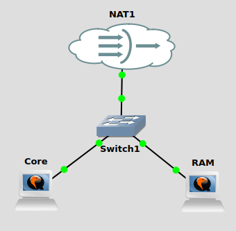
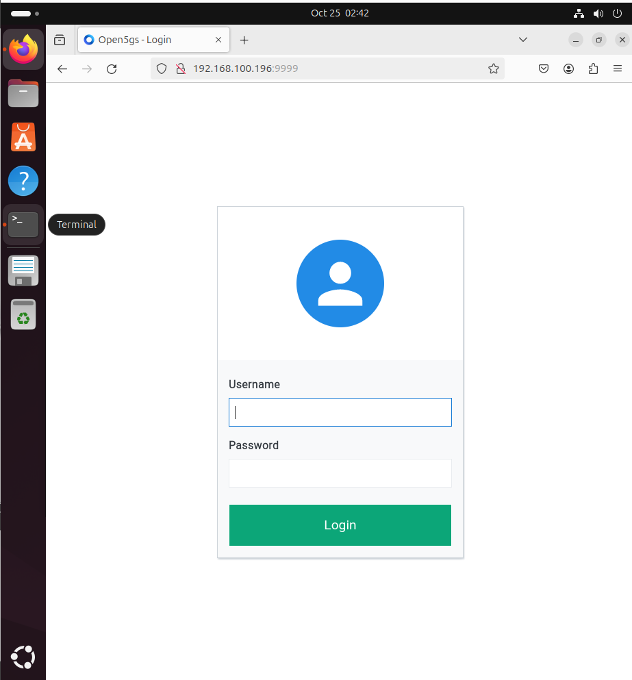

# byuro1440

# Инструкция по настройке лабораторного стенда 5G (Open5GS + [UERANSIM](https://github.com/aligungr/UERANSIM)) в GNS3

## 1. Архитектура и параметры

  

| Компонент | Роль | Компоненты | Адрес |
|---| --- |---|---|
| Core-VM | Ядро сети 5G | Open5GS (AMF, SMF, UPF, NRF, SCP, AUSF, UDM, UDR, PCF), WebUI, MongoDB | `<IP-Core-VM>`  |
| RAN-VM | Базовая станция и абонент | [UERANSIM](https://github.com/aligungr/UERANSIM): gNB + UE | `<IP-RAN-VM>` |

Параметры сети 5G:
- **PLMN**: `999/70`
- **TAC**: `1`
- **DNN**: `internet`
- **Пул UE**: `10.45.0.0/16`, шлюз `10.45.0.1`
- **IMSI**: `999700000000001`
- **K**: `465B5CE8B199B49FAA5F0A2EE238A6BC`
- **OPc**: `E8ED289DEBA952E4283B54E88E6183CA`

Сетевая связность: обе ВМ в подсети 192.168.100.0/24 (через узел NAT в GNS3). Актуальные адреса для настроек можно узнать с помощью команды `ip addr` (интерфейс ens3).

---

## 2. Настройка Core-VM
### 2.1. Настройка MongoDB через Docker
Стандартная установка MongoDB 8.0 через `apt` не работает на процессорах без AVX (ошибка `signal=ILL`). Используется Docker-образ `mongo:4.4`.

~~~
sudo apt update
sudo apt install -y docker.io
sudo systemctl enable --now docker

sudo docker run -d --name mongodb --restart=always \
  -p 27017:27017 \
  -v mongodb_data:/data/db \
  mongo:4.4
~~~

Проверка:
~~~
sudo docker ps | grep mongodb
sudo ss -tlnp | grep 27017
~~~

> `mongo:4.4` — последняя версия без требования AVX. Содержит старый shell `mongo` (не `mongosh`).

### 2.2. Установка ядра Open5GS

~~~
sudo add-apt-repository ppa:open5gs/latest -y
sudo apt update
sudo apt install -y open5gs
~~~

### 2.3. Настройка WebUI через Docker

Так как MongoDB работает через Docker невозможно собрать WebUI автоматически, так как во время сборки ищется пакет MongoDB. Сборка WebUI из исходников на Node.js 22 падает с `Unexpected token` из-за несовместимости старых зависимостей Next.js. Вследствие вышеуказаных проблем используется готовый Docker-образ.

~~~
sudo docker rm -f webui 2>/dev/null
sudo docker run -d --name webui --restart=always \
  -p 9999:9999 \
  -e DB_URI=mongodb://<IP-Core-VM>:27017/open5gs \
  higebu/open5gs-webui:v2.8.0
~~~

> Подставьте актуальный <IP-Core-VM> в `DB_URI`.

Проверка:
~~~
sudo docker ps | grep webui
sudo docker logs webui --tail 20
~~~

WebUI доступен по адресу `http://<IP-Core-VM>:9999/`. Логин `admin`, пароль `1423`.

### 2.4. Настройка AMF

Файл `/etc/open5gs/amf.yaml`:

> Подставьте актуальный IP-Core-VM в конфигурацию. Используемый файл приведен в [configs/amf.yaml](configs/amf.yaml)

~~~yaml
amf:
  ngap:
    server:
      - address: <IP-Core-VM>
  guami:
    - plmn_id:
        mcc: 999
        mnc: 70
  tai:
    - plmn_id:
        mcc: 999
        mnc: 70
      tac: 1
  plmn_support:
    - plmn_id:
        mcc: 999
        mnc: 70
      s_nssai:
        - sst: 1
~~~

Перезапуск:
~~~
sudo systemctl restart open5gs-amfd
~~~

### 2.5. Настройка UPF

Файл `/etc/open5gs/upf.yaml`, секция `gtpu`:

> Подставьте актуальный IP-Core-VM в конфигурацию. Используемый файл приведен в [configs/upf.yaml](configs/upf.yaml)

~~~yaml
  gtpu:
    server:
      - address: <IP-Core-VM>
~~~

Перезапуск:
~~~
sudo systemctl restart open5gs-upfd
~~~

Проверка:
~~~
sudo ss -ulnp | grep 2152   # должно быть <IP-Core-VM>:2152
~~~

### 2.6. Создание интерфейса ogstun и NAT
UPF обычно создаёт ogstun сам, но необходимо проверить:

~~~
ip addr show ogstun   # должен быть 10.45.0.1/16
~~~

Включение форвардинга и NAT:

~~~
sudo sysctl -w net.ipv4.ip_forward=1
echo "net.ipv4.ip_forward=1" | sudo tee -a /etc/sysctl.conf

sudo iptables -t nat -A POSTROUTING -s 10.45.0.0/16 -o ens3 -j MASQUERADE
sudo iptables -I FORWARD -i ogstun -j ACCEPT
sudo iptables -I FORWARD -o ogstun -j ACCEPT
sudo iptables -I INPUT -i ogstun -j ACCEPT

sudo apt install -y iptables-persistent
sudo netfilter-persistent save
~~~

> Явное указание -o ens3 в MASQUERADE часто решает проблему, когда трафик UE не выходит в интернет.

### 2.7. Добавление абонента

Через WebUI (`http://<IP-Core-VM>:9999/`, `admin`/`1423`):

| Поле | Значение |
|---|---|
| IMSI | `999700000000001` |
| K | `465B5CE8B199B49FAA5F0A2EE238A6BC` |
| USIM Type | `OPc` |
| OPc | `E8ED289DEBA952E4283B54E88E6183CA` |
| AMF | `8000` |
| DNN | `internet` |
| Session Type | `IPv4` |
| SST | `1` |

### 2.8. Проверка служб

~~~
systemctl status open5gs-amfd open5gs-smfd open5gs-upfd open5gs-nrfd open5gs-scpd --no-pager
~~~

Все -- `active (running)`.

Включение автозапуска после перезагрузки

~~~
sudo systemctl enable open5gs-nrfd open5gs-scpd open5gs-amfd open5gs-smfd open5gs-upfd open5gs-ausfd open5gs-udmd open5gs-udrd open5gs-pcfd
~~~

## 3. Настройка RAN-VM
### 3.1. Сборка UERANSIM

~~~
sudo apt update
sudo apt install -y make g++ libsctp-dev lksctp-tools iproute2 git cmake
git clone https://github.com/aligungr/UERANSIM
cd UERANSIM
make -j$(nproc)
~~~

### 3.2. Настройка gNB

`~/UERANSIM/config/open5gs-gnb.yaml`:

~~~yaml
mcc: '999'
mnc: '70'
tac: 1

linkIp: <IP-RAN-VM>
ngapIp: <IP-RAN-VM>
gtpIp: <IP-RAN-VM>

amfConfigs:
  - address: <IP-Core-VM>
    port: 38412

slices:
  - sst: 1
~~~

---

### 3.3. Настройка UE

`~/UERANSIM/config/open5gs-ue.yaml`:

~~~yaml
supi: 'imsi-999700000000001'
mcc: '999'
mnc: '70'

key: '465B5CE8B199B49FAA5F0A2EE238A6BC'
op: 'E8ED289DEBA952E4283B54E88E6183CA'
opType: 'OPC'
amf: '8000'

gnbSearchList:
  - <IP-RAN-VM>

sessions:
  - type: 'IPv4'
    apn: 'internet'
    slice:
      sst: 1
~~~

---

## 4. Запуск стенда

**Core-VM**: убедитесь, что MongoDB и службы запущены:
~~~
sudo docker start mongodb
systemctl status open5gs-amfd open5gs-smfd open5gs-upfd open5gs-nrfd --no-pager
~~~

**RAN-VM, терминал 1 -- gNB:**
~~~
cd ~/UERANSIM
sudo ./build/nr-gnb -c config/open5gs-gnb.yaml
~~~

Ждём `NG Setup procedure is successful`.

**RAN-VM, терминал 2 -- UE:**
~~~
cd ~/UERANSIM
sudo ./build/nr-ue -c config/open5gs-ue.yaml
~~~

Ждём `TUN interface[uesimtun0, 10.45.0.x] is up`.

**Проверка:**
~~~
ping -I 10.45.0.x -c 4 8.8.8.8
~~~

## 15. Каталог неисправностей

На стенде воспроизведены и описаны:

1. Неверный DNN
2. Рассогласование ключей (K/OPc)
3. Несовпадение PLMN
4. Некорректный MTU
5. Потерянный маршрут
6. Отключённый NRF (+SCP)
7. Отсутствующий абонент в WebUI
8. Недоступность PCF
9. Отключение SMF
10. Падение AMF

Для каждой подготовлены скрипты `break_*.sh` / `fix_*.sh` и шаблон описания.

---

## 16. Wireshark: где смотреть неисправности

| Неисправность | Интерфейс | Фильтр | Что искать |
|---|---|---|---|
| Неверный DNN | Core-VM `ens3` | `ngap` / поиск hex `77726f6e675f646e6e` | `wrong_dnn` в `UplinkNASTransport` |
| Ключи (K/OPc) | Core-VM `ens3` | `nas_5gs` | `Authentication Failure`, cause #20 |
| PLMN | Core-VM `ens3` | `ngap` | `NG Setup Failure`, `PLMN-ID is foreign` |
| MTU | Core-VM `ogstun` | `icmp` | Крупные пакеты не доходят / нет ответа |
| Маршрут | RAN-VM `uesimtun0` | `icmp` | Пакетов нет вообще |
| NRF | Core-VM `ens3` | `tcp.port == 7777` | `RST` или таймаут к NRF/SCP |
| Абонент | Core-VM `ens3` | `nas_5gs` | `Registration Reject` (#3/#7) |
| PCF | Core-VM `ens3` | `http2` | Таймаут запроса к PCF |
| SMF | Core-VM `ens3` | `http2` | Таймаут `CreateSMContext` |
| AMF | Core-VM `ens3` | `sctp.port == 38412` | Разрыв SCTP, нет ответов |

