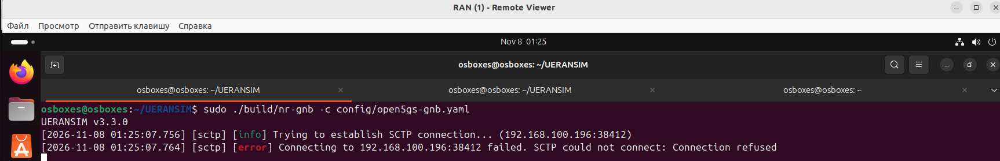
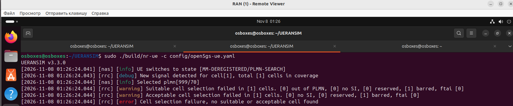

## Демонстрация неисправности: Падение AMF (Access and Mobility Management Function)

### 1. Скрипты

[**`break_amf.sh`**](../scripts/break_amf.sh)

[**`fix_amf.sh`**](../scripts/fix_amf.sh.sh)

### 2. Воспроизведение

На Core-VM:
~~~bash
bash break_amf.sh
~~~

На RAN-VM перезапустите gNB и UE:
~~~bash
sudo pkill -f nr-ue
sudo pkill -f nr-gnb
sudo ./build/nr-gnb -c config/open5gs-gnb.yaml
# в другом терминале:
sudo ./build/nr-ue -c config/open5gs-ue.yaml
~~~

### 3. Где искать и что смотреть

#### Логи gNB (RAN-VM) — основной симптом

При запуске gNB не сможет установить SCTP-соединение с AMF. В логе gNB появится:
~~~
[sctp] [info] Trying to establish SCTP connection... (192.168.100.196:38412)
[sctp] [error] SCTP connection failed
~~~
Или таймаут. NG Setup не пройдёт, и UE не сможет даже начать регистрацию.

  

#### Логи UE (RAN-VM)

UE не увидит сеть или не сможет отправить `Registration Request`.

  

#### Проверка на Core-VM

~~~bash
systemctl status open5gs-amfd --no-pager
~~~
Должно быть `inactive (dead)` или `failed`.

Проверьте, что порт NGAP (SCTP 38412) больше не слушается:
~~~bash
sudo ss -Slnp | grep 38412
~~~
Вывод должен быть пустым (раньше вы видели `192.168.100.196:38412`).

#### Wireshark (захват на dummy0)

**Что искать:**
- При запуске gNB отправляет `NGSetupRequest` (SCTP INIT), но **ответа нет** (AMF не слушает порт).
- В дампе будут видны повторные попытки SCTP-соединения или ICMP `Destination Unreachable` (если порт закрыт).
- Если UE уже было зарегистрировано до остановки AMF, трафик N2 просто исчезнет.

> **Важно**: В отличие от остановки SMF или PCF, здесь падает самый первый компонент цепочки. Без AMF gNB не может подключиться к ядру, и UE не может зарегистрироваться вообще.

### 4. Устранение

~~~bash
bash fix_amf.sh
~~~

Затем на RAN-VM:
~~~bash
sudo pkill -f nr-gnb
sudo ./build/nr-gnb -c config/open5gs-gnb.yaml
# дождитесь NG Setup procedure is successful
sudo ./build/nr-ue -c config/open5gs-ue.yaml
~~~

### 5. Сводная таблица для каталога

| Поле | Содержание |
|---|---|
| **Название** | Падение AMF (Access and Mobility Management Function) |
| **Симптом в логах gNB** | `SCTP connection failed`, таймаут при попытке подключения к `192.168.100.196:38412` |
| **Симптом в логах UE** | Регистрация не начинается (UE не видит сеть или таймаут на RRC) |
| **Симптом в Wireshark** | Нет ответа на `NGSetupRequest`; SCTP-соединение не устанавливается |
| **Поведение абонента** | Сеть полностью недоступна, `uesimtun0` не появляется |
| **Локализация** | `systemctl status open5gs-amfd` — `inactive`; `ss -Slnp \| grep 38412` — пусто |
