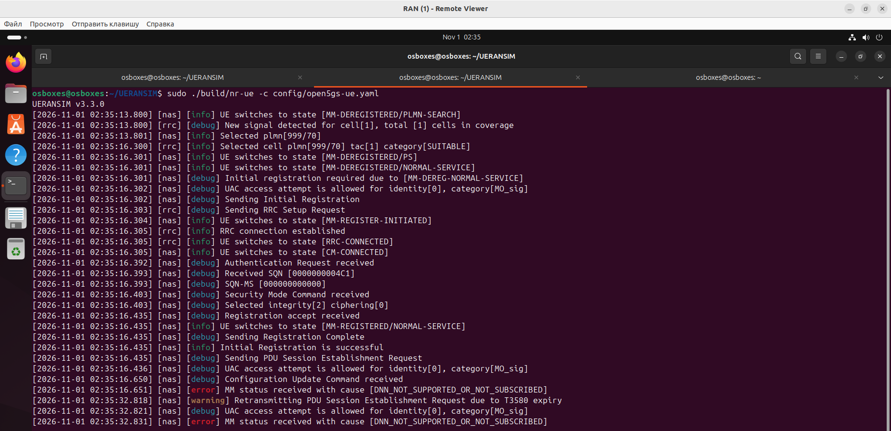
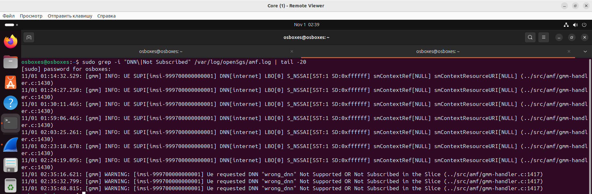
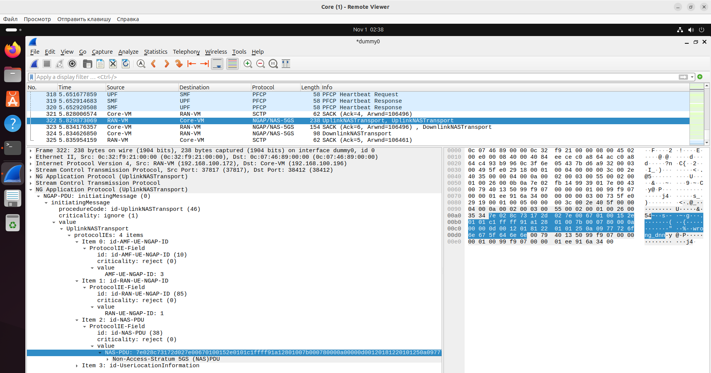

## Демонстрация неисправности: Неверный DNN

### 1. Скрипты

**`break_dnn.sh`**

**`fix_dnn.sh`**

### 2. Воспроизведение

~~~bash
cd ~/UERANSIM
bash break_dnn.sh
sudo pkill -f nr-ue
sudo ./build/nr-ue -c config/open5gs-ue.yaml
~~~

### 3. Где искать и что смотреть

#### Логи UE (RAN-VM)

После перезапуска UE в логе появится:
~~~
[nas] [error] MM status received with cause [DNN_NOT_SUPPORTED_OR_NOT_SUBSCRIBED]
~~~

  

Это прямая причина отказа: сеть сообщает, что запрошенный DNN не поддерживается или не прописан в подписке.

#### Логи AMF (Core-VM)

~~~bash
sudo grep -i "DNN\|Not Subscribed" /var/log/open5gs/amf.log | tail -20
~~~
Ищите строку:
~~~
DNN "wrong_dnn" Not Supported OR Not Subscribed in the Slice
~~~

  

Это подтверждает, что AMF отклонил выбор SMF для данного DNN.

#### Wireshark (захват на dummy0)

**Где именно смотреть:**
1. Найдите пакет `UplinkNASTransport`.
2. Внутри него — `NAS-PDU`.
3. В **hex-дампе** ближе к концу пакета вы увидите последовательность `...09 77 72 6f 6e 67 5f 64 6e 6e`.
4. Это и есть запрошенный DNN `wrong_dnn`.

  

**Альтернативно (если DNN зашифрован):** ищите пакет `5GMM Status` (message type `0x59` или `0x7e` с cause `DNN_NOT_SUPPORTED`). Причина отказа в нём также видна в открытом виде.

### 4. Устранение

~~~bash
cd ~/UERANSIM
bash fix_dnn.sh
sudo pkill -f nr-ue
sudo ./build/nr-ue -c config/open5gs-ue.yaml
~~~

После перезапуска дождитесь `PDU Session establishment is successful` и `TUN interface[uesimtun0, ...] is up`, затем проверьте:
~~~bash
ping -I 10.45.0.x -c 2 8.8.8.8
~~~

### 5. Сводная таблица для каталога

| Поле | Содержание |
|---|---|
| **Название** | Неверный DNN (Data Network Name) |
| **Симптом в логах UE** | `MM status received with cause [DNN_NOT_SUPPORTED_OR_NOT_SUBSCRIBED]` |
| **Симптом в логах AMF** | `DNN "wrong_dnn" Not Supported OR Not Subscribed in the Slice` |
| **Симптом в Wireshark** | В `UplinkNASTransport` (NGAP) внутри NAS-PDU в hex виден `wrong_dnn` (`77 72 6f 6e 67 5f 64 6e 6e`) |
| **Поведение абонента** | Регистрация проходит, PDU-сессия не устанавливается, `uesimtun0` не поднимается |
| **Локализация** | Сравнить `apn` в `open5gs-ue.yaml` с DNN в подписке WebUI/MongoDB |
