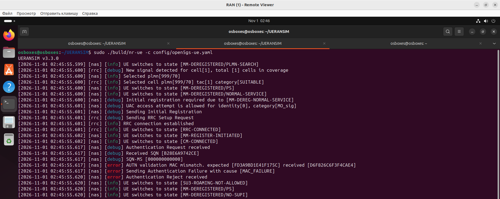
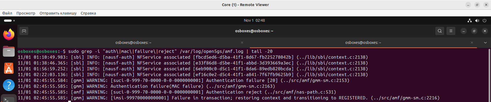
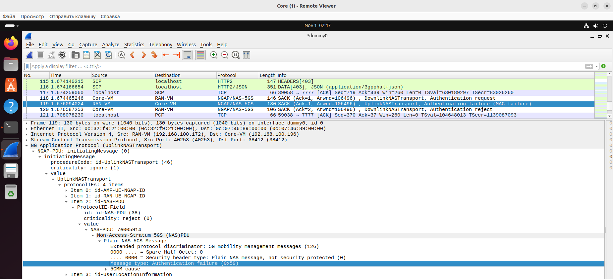
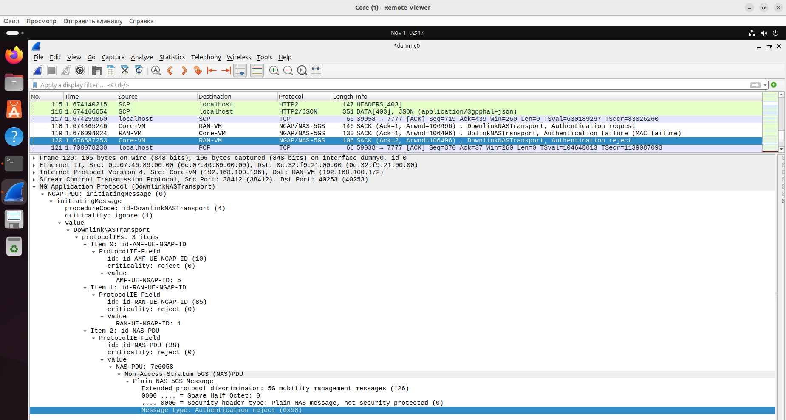

## Демонстрация неисправности: Рассогласование ключей (K / OPc)

### 1. Скрипты

**`break_keys.sh`** (RAN-VM):

**`fix_keys.sh`** (RAN-VM):

### 2. Воспроизведение

~~~bash
cd ~/UERANSIM
bash break_keys.sh
sudo pkill -f nr-ue
sudo ./build/nr-ue -c config/open5gs-ue.yaml
~~~

### 3. Где искать и что смотреть

#### Логи UE (RAN-VM)

После перезапуска UE в логе появится:
~~~
[nas] [error] AUTN validation MAC mismatch. expected [...] received [...]
[nas] [error] Sending Authentication Failure with cause [MAC_FAILURE]
[nas] [error] Authentication Reject received
~~~

  

Это прямая причина отказа: UE вычислил MAC с неверным K и отправил `Authentication Failure`.

#### Логи AMF (Core-VM)

~~~bash
sudo grep -i "auth\|mac\|failure\|reject" /var/log/open5gs/amf.log | tail -20
~~~
Ищите строки:
~~~
[gmm] WARNING: Authentication failure
~~~

  

#### Wireshark (захват на dummy0)

**Где именно смотреть:**
1. Найдите пакет `UplinkNASTransport`.
2. Внутри него — `NAS-PDU` → `Plain NAS 5GS Message` (пакет **не зашифрован**, потому что аутентификация ещё не завершена).
3. Разверните: `Message type: Authentication failure (0x59)` → `5GMM cause: MAC failure (20)`.

  

4. Следом идет пакет `Authentication reject`

  

### 4. Устранение

~~~bash
cd ~/UERANSIM
bash fix_keys.sh
sudo pkill -f nr-ue
sudo ./build/nr-ue -c config/open5gs-ue.yaml
~~~

После перезапуска дождитесь `Initial Registration is successful` и `TUN interface[uesimtun0, ...] is up`, затем проверьте:
~~~bash
ping -I 10.45.0.x -c 2 8.8.8.8
~~~

### 5. Сводная таблица для каталога

| Поле | Содержание |
|---|---|
| **Название** | Рассогласование ключей абонента (K / OPc) |
| **Симптом в логах UE** | `AUTN validation MAC mismatch` `Sending Authentication Failure with cause [MAC_FAILURE]`  `Authentication Reject received`|
| **Симптом в логах AMF** | `Authentication failure [20]`  `Authentication failure(MAC failure)`  `Authentication reject` |
| **Симптом в Wireshark** | `UplinkNASTransport` → `Plain NAS 5GS Message` → `Authentication failure (0x59)` → `5GMM cause: MAC failure (20)` |
| **Поведение абонента** | Регистрация не проходит, `uesimtun0` не поднимается. Отказ происходит до PDU-сессии |
| **Локализация** | Сравнить `key` и `op`/`opc` (и `opType`) в `open5gs-ue.yaml` с K и OPc в подписке WebUI/MongoDB |
