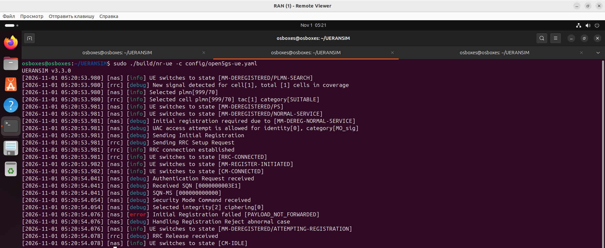
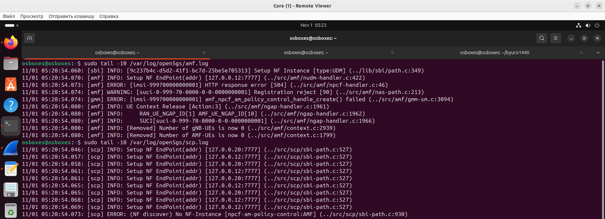
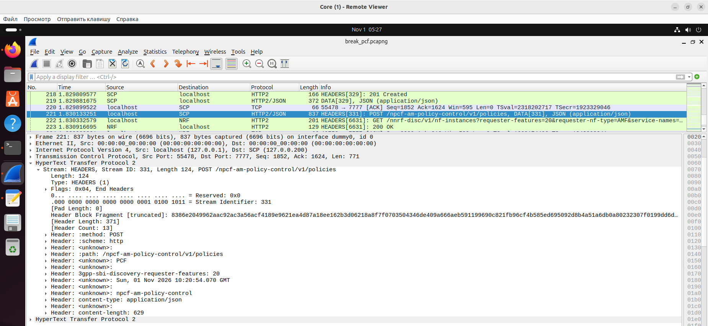
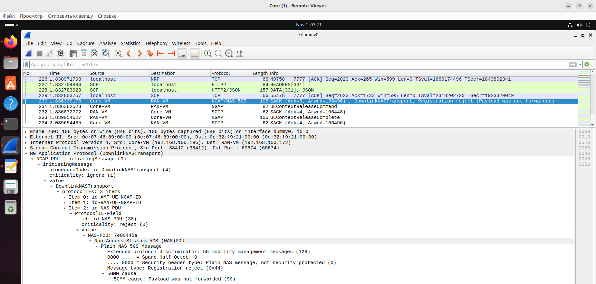

## Демонстрация неисправности: Недоступность PCF (Policy Control Function)

### 1. Скрипты

[**`break_pcf.sh`**](../scripts/break_pcf.sh)

[**`fix_pcf.sh`**](../scripts/fix_pcf.sh)

> В Open5GS PCF по умолчанию слушает `127.0.0.13:7777` (SBI). При остановке службы AMF не сможет получить политики для UE.

### 2. Воспроизведение

На Core-VM:
~~~bash
bash break_pcf.sh
~~~

На RAN-VM перезапустите UE:
~~~bash
sudo pkill -f nr-ue
sudo ./build/nr-ue -c config/open5gs-ue.yaml
~~~

### 3. Где искать и что смотреть

#### Логи UE (RAN-VM)

Регистрация не завершается. В логе UE появится таймаут или `Registration Reject`.

  

#### Логи AMF и SCP (Core-VM)

~~~bash
sudo tail -20 /var/log/open5gs/amf.log
~~~

Ищите строки:
~~~
[amf] ERROR: [imsi-...]HTTP response error [504]
[amf] WARNING: [suci-...] Registration reject [90]
[gmm] ERROR: [imsi-...] amf_npcf_am_policy_control_handle_create() failed
~~~

**Что это значит:**
- AMF запросил политики у PCF (через SCP).
- SCP не смог найти PCF и вернул **HTTP 504 (Gateway Timeout)**.
- AMF отклонил регистрацию с кодом **90** (причина, связанная с политиками).

~~~bash
sudo tail -20 /var/log/open5gs/scp.log
~~~
Ищите строки:
~~~
[scp] ERROR: (NF discover) No NF-Instance [npcf-am-policy-control:AMF]
~~~
SCP не нашёл PCF среди зарегистрированных сетевых функций.

  

#### Wireshark (захват на dummy0)

**Что искать:**
1. Трафик AMF → SCP (`127.0.0.200:7777`) присутствует. 
- AMF отправляет HTTP/2-запрос к PCF с URI `/npcf-am-policy-control/v1/policies`.
- Трафика SCP → PCF (`127.0.0.13:7777`) **нет**, потому что PCF остановлен.
- В ответ на запрос AMF приходит ошибка 504 (или соединение просто не устанавливается).

> **Важно**: В конфигурации AMF использует SCP для SBI-сигнализации (`amf.yaml` → `sbi.client.scp`). Поэтому в дампе нет прямого запроса к PCF — только к SCP. Это корректное поведение для архитектуры с прокси.

  

2. Ответа нет (таймаут) или приходит TCP RST (соединение отклонено), если PCF остановлен.
3. В ответ на запрос регистрации UE AMF отправляет `Registration reject` с причиной `5GMM cause 90 (Payload was not forwarded)`. 

  

### 4. Устранение

На Core-VM:

~~~bash
bash fix_pcf.sh
~~~

На RAN-VM перезапустите UE:
~~~bash
sudo pkill -f nr-ue
sudo ./build/nr-ue -c config/open5gs-ue.yaml
~~~

После перезапуска дождитесь `Initial Registration is successful` и проверьте ping.

### 5. Сводная таблица

| Поле | Содержание |
|---|---|
| **Название** | Недоступность PCF (Policy Control Function) |
| **Симптом в логах UE** | Регистрация не завершается, таймаут или `Registration Reject` |
| **Симптом в логах AMF** | `HTTP response error [504]`   `Registration reject [90]`   `amf_npcf_am_policy_control_handle_create() failed` |
| **Симптом в логах SCP** | `ERROR: (NF discover) No NF-Instance [npcf-am-policy-control:AMF]` |
| **Симптом в Wireshark** | Трафик AMF → SCP (`127.0.0.200:7777`) есть; SCP → PCF (`127.0.0.13:7777`) нет |
| **Поведение абонента** | Регистрация не проходит, `uesimtun0` не появляется |
| **Локализация** | `systemctl status open5gs-pcfd` — `inactive`. В `amf.log` — ошибка 504; в `scp.log` — `No NF-Instance` |
