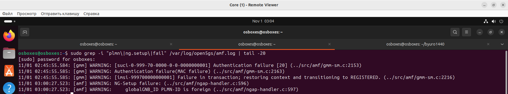
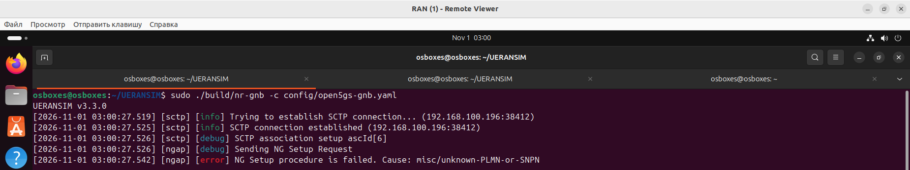
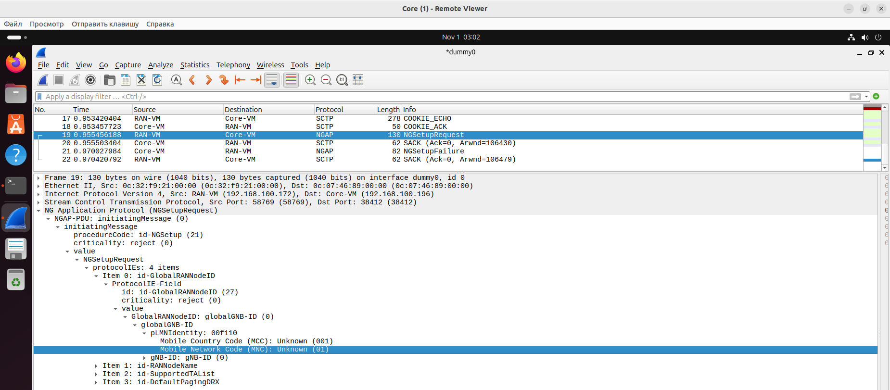
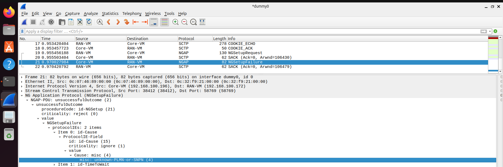

## Демонстрация неисправности: Несовпадение PLMN

### 1. Скрипты

[**`break_plmn.sh`**](../scripts/break_plmn.sh)

[**`fix_plmn.sh`**](../scripts/fix_plmn.sh)

### 2. Воспроизведение

~~~bash
cd ~/UERANSIM
bash break_plmn.sh
sudo pkill -f nr-ue
sudo pkill -f nr-gnb
sudo ./build/nr-gnb -c config/open5gs-gnb.yaml
~~~

### 3. Где искать и что смотреть

#### Логи AMF (Core-VM)

~~~bash
sudo grep -i "plmn\|ng.setup\|fail" /var/log/open5gs/amf.log | tail -20
~~~
Ищите строки:
~~~
[amf] WARNING: NG-Setup failure:
[amf] WARNING:     globalGNB_ID PLMN-ID is foreign
~~~

  

Это прямое указание на то, что PLMN, который прислал gNB, не совпадает с тем, что настроен в AMF.

#### Логи gNB (RAN-VM)

В терминале, где запущен gNB, после отправки `NG Setup Request` вы не увидите `NG Setup procedure is successful`. Вместо этого будет ошибка или таймаут.

  

#### Wireshark (захват на dummy0)

**Где именно смотреть:**
1. Найдите пакет `NGSetupRequest` (от gNB к AMF).
2. Внутри него разверните `GlobalRANNodeID` → `GlobalGNB-ID` → `PLMNIdentity`. Вы увидите `mcc=xxx, mnc=xx`.

  

3. Следом должен идти пакет **`NGSetupFailure`** (от AMF к gNB).
4. В `NGSetupFailure` разверните `Cause`.

  

> **Важно**: Если AMF настроен корректно, но в его конфигурации `plmn_support` нет PLMN, который прислал gNB, NG Setup будет отклонён.

### 4. Устранение

~~~bash
cd ~/UERANSIM
bash fix_plmn.sh
sudo pkill -f nr-gnb
sudo ./build/nr-gnb -c config/open5gs-gnb.yaml
~~~

После перезапуска дождитесь `NG Setup procedure is successful`, затем запустите UE:
~~~bash
sudo ./build/nr-ue -c config/open5gs-ue.yaml
~~~
После перезапуска дождитесь `PDU Session establishment is successful` и `TUN interface[uesimtun0, ...] is up`, затем проверьте:
~~~bash
ping -I 10.45.0.x -c 2 8.8.8.8
~~~

### 5. Сводная таблица

| Поле | Содержание |
|---|---|
| **Название** | Несовпадение PLMN между gNB и AMF |
| **Симптом в логах AMF** | `NG-Setup failure:`   `globalGNB_ID PLMN-ID is foreign` |
| **Симптом в логах gNB** | Нет `NG Setup procedure is successful`, ошибка или таймаут |
| **Симптом в Wireshark** | `NGSetupRequest` содержит PLMN, отличный от AMF; ответ — `NGSetupFailure` с причиной, связанной с PLMN |
| **Поведение абонента** | gNB не подключается к Core, UE не видит сеть или не может зарегистрироваться |
| **Локализация** | Сравнить `mcc`/`mnc` в `open5gs-gnb.yaml` и в `amf.yaml` (секции `guami`, `tai`, `plmn_support`) |
