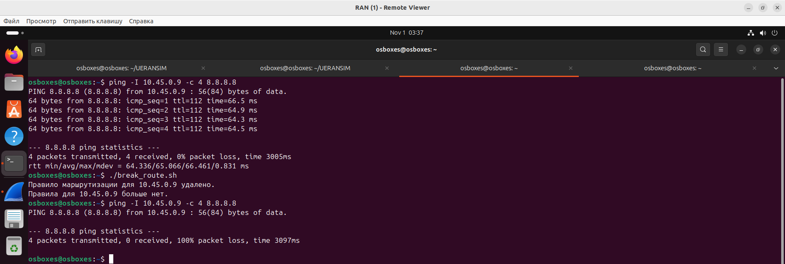
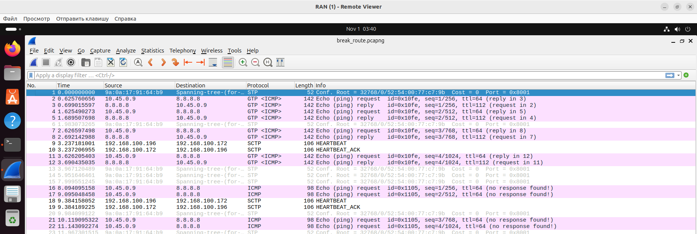

## Демонстрация неисправности: Потерянный маршрут

### 1. Скрипты

[**`break_route.sh`**](../scripts/break_route.sh.sh)

[**`fix_route.sh`**](../scripts/fix_route.sh)

### 2. Воспроизведение

На RAN-VM (UE уже запущен, ping работает):
~~~bash
# Убедитесь, что ping идёт
ping -I 10.45.0.x -c 2 8.8.8.8

# Внесите неисправность
bash break_route.sh
~~~

### 3. Где искать и что смотреть

#### Логи UE (RAN-VM)

В логе UE ошибок не будет — регистрация и PDU-сессия уже установлены. Проблема проявляется только в том, что **ping перестаёт проходить**, хотя `uesimtun0` остаётся поднятым.

  

Проверьте:
~~~bash
ip route get 8.8.8.8 from 10.45.0.x
~~~
Если вывод показывает `dev ens3` вместо `dev uesimtun0` — маршрут потерян.

#### Wireshark (захват на ens3 RAAN-VM)

**Что искать:**
- На `ens3` пакеты не идут в туннель, отправляются напрямую с ens3.

  

> **Важно**: В отличие от DNN или ключей, здесь нет сообщений об ошибках в сигнализации. Проблема чисто в маршрутизации на хосте RAN-VM.

#### Проверка правил маршрутизации

На RAN-VM:
~~~bash
ip rule show
ip route show table rt_uesimtun0
~~~
Если правила `from 10.45.0.x lookup rt_uesimtun0` нет — трафик UE не направляется в туннель.

### 4. Устранение

~~~bash
bash fix_route.sh
~~~

Проверьте:
~~~bash
ip route get 8.8.8.8 from 10.45.0.x
ping -I 10.45.0.x -c 2 8.8.8.8
~~~

### 5. Сводная таблица

| Поле | Содержание |
|---|---|
| **Название** | Потерянный маршрут между сегментами (RAN-VM) |
| **Симптом в логах** | Ошибок в Open5GS/UERANSIM нет — регистрация и PDU-сессия проходят успешно |
| **Симптом в Wireshark** | На `uesimtun0` пакеты отсутствуют, уходят через `ens3` |
| **Поведение абонента** | `uesimtun0` поднят, IP есть, но `ping -I 10.45.0.x 8.8.8.8` не проходит |
| **Локализация** | `ip route get 8.8.8.8 from 10.45.0.x` показывает `dev ens3` вместо `dev uesimtun0` |
