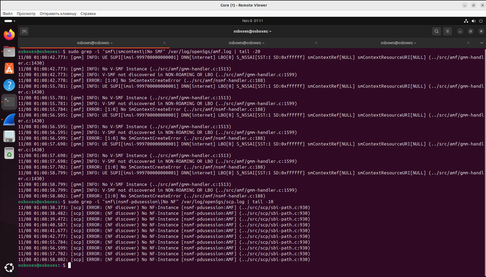
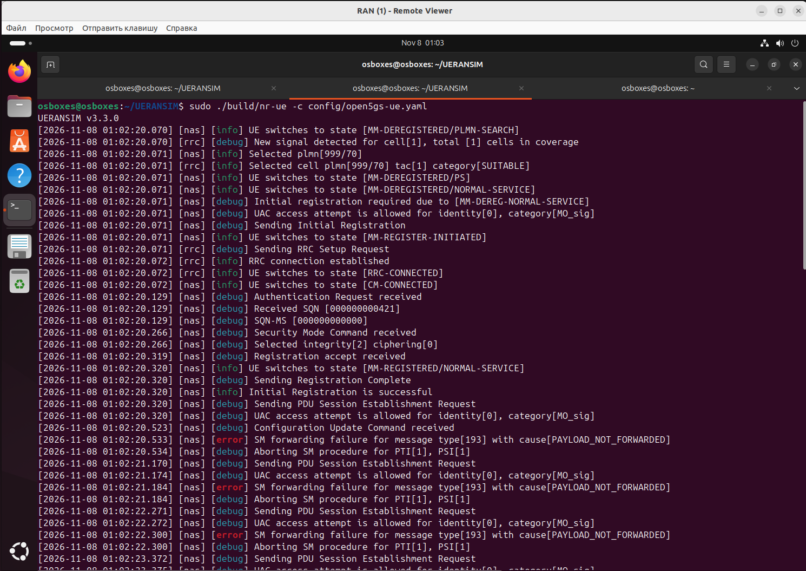
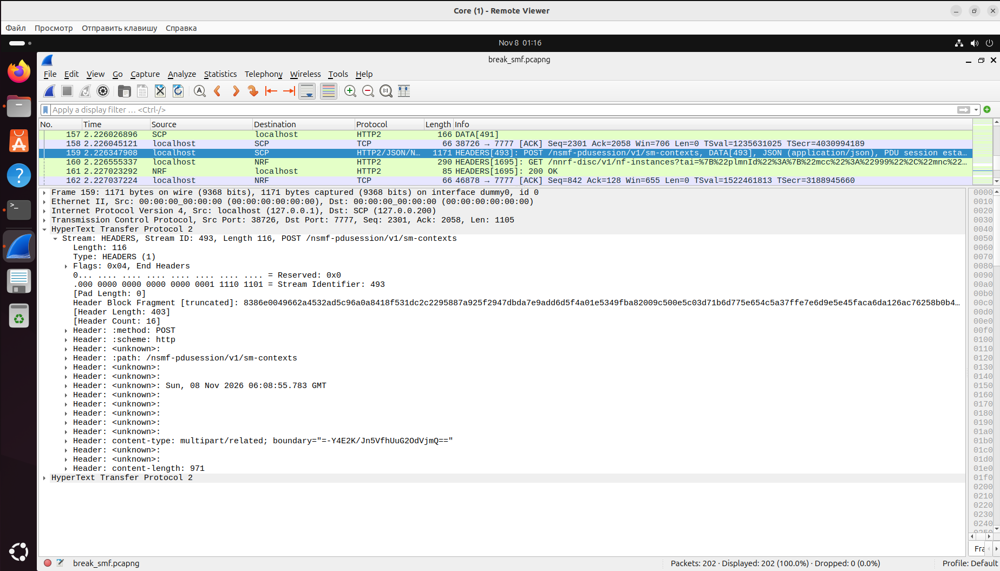

## Демонстрация неисправности: Отключение SMF (Session Management Function)

### 1. Скрипты

[**`break_smf.sh`**](../scripts/break_smf.sh)

[**`fix_smf.sh`**](../scripts/fix_smf.sh)

### 2. Воспроизведение

На Core-VM:
~~~bash
bash break_smf.sh
~~~

На RAN-VM перезапустите UE:
~~~bash
sudo pkill -f nr-ue
sudo ./build/nr-ue -c config/open5gs-ue.yaml
~~~

### 3. Где искать и что смотреть

#### Логи AMF (Core-VM) — основной симптом

Выполните:
~~~bash
sudo grep -i "smf\|smcontext\|No SMF" /var/log/open5gs/amf.log | tail -20
~~~

Вы увидите строки, характерные для недоступности SMF:
~~~
[amf] INFO: No V-SMF Instance (../src/amf/gmm-handler.c:...)
[amf] ERROR: [1:0] No SmContextCreateError (../src/amf/nsmf-handler.c:...)
~~~

**Что это значит:** AMF попытался найти SMF для обработки запроса на PDU-сессию, но не смог (SMF не зарегистрирован в NRF или недоступен). В результате создание SM-контекста завершилось ошибкой, и UE получило отказ.

#### Логи SCP (Core-VM) — подтверждение

~~~bash
sudo grep -i "smf\|nsmf-pdusession\|No NF" /var/log/open5gs/scp.log | tail -10
~~~

Ищите строку:
~~~
[scp] ERROR: (NF discover) No NF-Instance [nsmf-pdusession:AMF]
~~~

Это означает, что SCP не смог найти SMF среди зарегистрированных сетевых функций.

  

#### Логи UE (RAN-VM)

Регистрация UE **может пройти успешно** (если AMF и UDM/AUSF работают), но PDU-сессия не установится. В логе UE вы увидите:
~~~
Initial Registration is successful
Sending PDU Session Establishment Request
...
PDU Session establishment is successful # НЕ будет
~~~

  

В отличие от неверного DNN (где приходит `Reject`), здесь UE может просто не получить ответа (таймаут) или получить отказ с общей причиной.

#### Wireshark (захват на dummy0)

**Что искать:**
- AMF отправляет запрос `POST /nsmf-pdusession/v1/sm-contexts` к SCP (`127.0.0.200:7777`).

  

- SCP не может найти SMF и возвращает ошибку (504 или 400).
- Трафика SCP → SMF (`127.0.0.4:7777`) **нет**, потому что SMF остановлен.

> **Важно**: Как и с PCF, в конфигурации AMF общается с SMF через SCP. Прямого запроса к `127.0.0.4` в дампе не будет.

### 4. Устранение

~~~bash
bash fix_smf.sh
~~~

Затем на RAN-VM:
~~~bash
sudo pkill -f nr-ue
sudo ./build/nr-ue -c config/open5gs-ue.yaml
~~~

Дождитесь `PDU Session establishment is successful` и проверьте:
~~~bash
ping -I 10.45.0.x -c 2 8.8.8.8
~~~

### 5. Сводная таблица для каталога

| Поле | Содержание |
|---|---|
| **Название** | Отключение SMF (Session Management Function) |
| **Симптом в логах AMF** | `No V-SMF Instance`   `No SmContextCreateError`  |
| **Симптом в логах SCP** | `(NF discover) No NF-Instance [nsmf-pdusession:AMF]` |
| **Симптом в логах UE** | Регистрация проходит, но PDU-сессия не устанавливается (таймаут или отказ) |
| **Симптом в Wireshark** | AMF → SCP (`127.0.0.200:7777`) есть; SCP → SMF (`127.0.0.4:7777`) нет |
| **Поведение абонента** | `uesimtun0` не появляется, интернета нет |
| **Локализация** | `systemctl status open5gs-smfd` — `inactive`; в `amf.log` — `No V-SMF Instance` |
