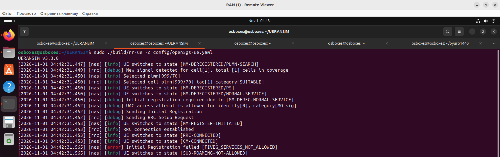
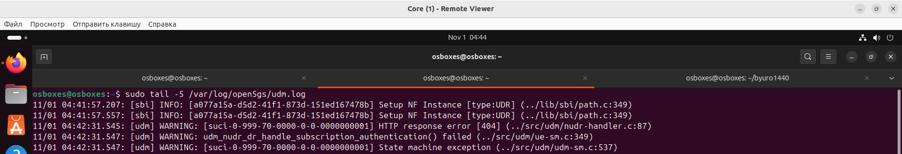
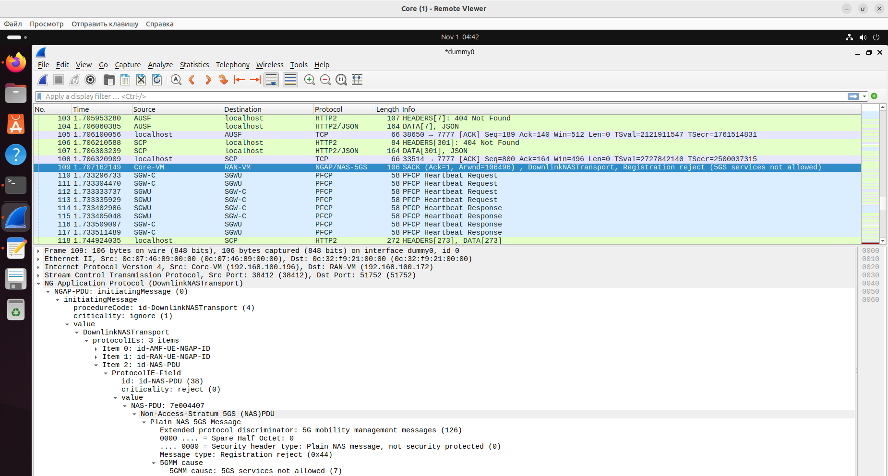

## Демонстрация неисправности: Отсутствующий абонент в WebUI

### 1. Скрипты

[**`break_subscriber.sh`**](../scripts/break_subscriber.sh)

[**`fix_subscriber.sh`**](../scripts/fix_subscriber.sh)

> **Важно**: используется `mongodump`/`mongorestore` (а не ручной `insertOne`), потому что они корректно сохраняют все поля документа, включая `_id` и типы BSON.

### 2. Воспроизведение

На Core-VM:
~~~bash
bash break_subscriber.sh
~~~

На RAN-VM перезапустите UE:
~~~bash
sudo pkill -f nr-ue
sudo ./build/nr-ue -c config/open5gs-ue.yaml
~~~

### 3. Где искать и что смотреть

#### Логи UE (RAN-VM)

Регистрация не завершается. В логе появится `Registration Reject` с причиной:
~~~
Initial Registration failed
~~~

  

#### Логи AMF / UDM (Core-VM)

На Core-VM выполните:
~~~bash
sudo grep -i "Cannot find IMSI\|User not found\|imsi-999700000000001" /var/log/open5gs/udm.log | tail -20
~~~

Ищите строки:
~~~
[udm] WARNING: [suci-...] HTTP response error [404]
~~~

  

Это прямое указание, что UDM не нашёл абонента в базе.

#### Wireshark (захват на dummy0)

**Что искать:**
1. UE отправляет `Registration Request` (виден IMSI/SUCI в открытом виде).
2. AMF/UDM не находит абонента.
3. Сеть отвечает `Registration Reject`.

  

В отличие от DNN, здесь отказ происходит **до** аутентификации (или на этапе получения векторов), и причина видна в NAS-сообщении.

### 4. Устранение

На Core-VM:
~~~bash
bash fix_subscriber.sh
sudo pkill -f nr-ue
sudo ./build/nr-ue -c config/open5gs-ue.yaml
~~~

На RAN-VM перезапустите UE:
~~~bash
cd ~/UERANSIM
sudo pkill -f nr-ue
sudo ./build/nr-ue -c config/open5gs-ue.yaml
~~~

После перезапуска дождитесь `Initial Registration is successful` и проверьте ping.

### 5. Сводная таблица для каталога

| Поле | Содержание |
|---|---|
| **Название** | Отсутствующий абонент в WebUI (IMSI не заведён в базе) |
| **Симптом в логах UE** | `Initial Registration failed` |
| **Симптом в логах UDM** | `HTTP response error [404]` |
| **Симптом в Wireshark** | `Registration Request` → `Registration Reject` |
| **Поведение абонента** | Сеть не пускает, `uesimtun0` не появляется |
| **Локализация** | Сравнить `supi` в `open5gs-ue.yaml` с IMSI в коллекции `subscribers` MongoDB |
